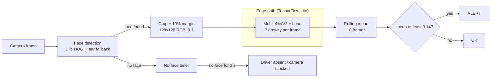
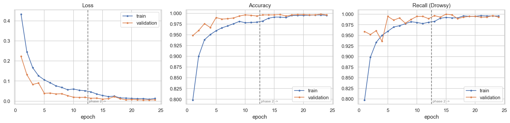
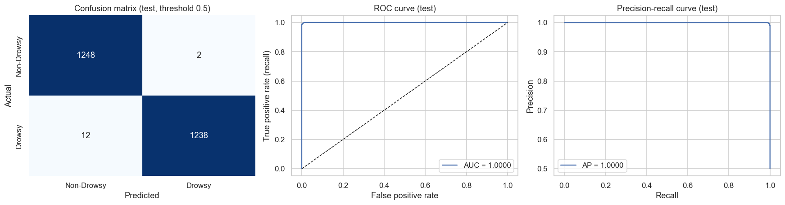
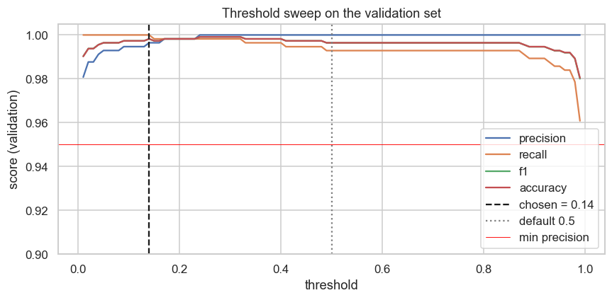
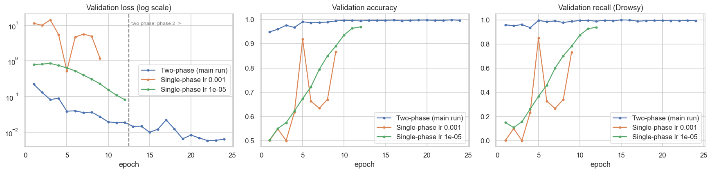
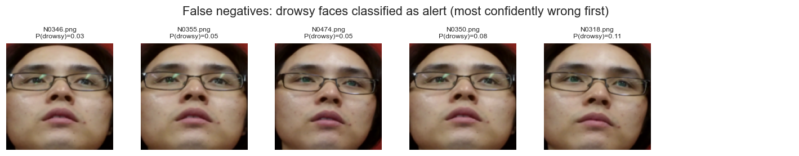

# Driver Drowsiness Detection

Real-time driver drowsiness detection from a single camera: a MobileNetV2 classifier on face crops, tuned for recall and exported to TensorFlow Lite so it can run on an in-vehicle device.


## What it does and why it matters

Driver fatigue is a leading cause of road accidents, and rule-based alerts (hours-of-service limits, lane-departure warnings) only react after driving has already degraded. This project classifies each camera frame as **drowsy** or **non-drowsy** directly from the driver's face, then smooths the decision over a short window before alerting. The model has to run inside the vehicle with no cloud connection, so the project ends with TensorFlow Lite conversion and a size / accuracy / latency comparison of four quantization variants.

It is an end-to-end case study: data inspection, face detection, transfer learning with two-phase fine-tuning, threshold selection for recall, error analysis, edge export and a real-time demo. The refactored package in `src/drowsiness/` reproduces the logic of the executed notebook in `notebooks/`.

## Pipeline



Training runs in two phases (frozen backbone, then fine-tuning of the last 30 layers), the alert threshold is chosen on a validation set, and the trained model is converted to TFLite (`models/drowsiness_float16.tflite` is the recommended variant and ships with the repository).

## Results

All numbers below come from the executed notebook and are copied in `results/` (`final_results.csv`, `tflite_comparison.csv`, `ablation_comparison.csv`). Test set: 2,500 images (1,250 per class), evaluated once, never used for training, early stopping or threshold selection. Drowsy is the positive class, so a false negative is a missed drowsy driver.

### Test metrics

| Threshold | Accuracy | Precision | Recall | F1 | Missed drowsy (FN) | False alarms (FP) |
|---|---|---|---|---|---|---|
| 0.5 (default) | 99.44% | 99.84% | 99.04% | 99.44% | 12 | 2 |
| **0.14 (chosen on validation)** | **99.52%** | 99.44% | **99.60%** | **99.52%** | **5** | 7 |

The threshold rule is "maximise validation recall subject to validation precision >= 95%, ties go to the highest threshold". Lowering the threshold from 0.5 to 0.14 removes 7 of the 12 missed drowsy frames at the cost of 5 extra false alarms. ROC AUC is 1.0000 (rounded), which says more about how easy this test set is than about the model (see Limitations).

| Training curves | Test evaluation (threshold 0.5) |
|---|---|
|  |  |



### TensorFlow Lite variants (full test set, threshold 0.5, 1 CPU thread)

| Model | Size | vs Keras | Accuracy | Recall | Recall @ 0.14 | Latency / image |
|---|---|---|---|---|---|---|
| Keras `.keras` (inference only) | 9,998 KB | 1.00 | 99.44% | 99.04% | 99.60% | 19.3 ms (default threads) |
| TFLite float32 | 9,302 KB | 0.93 | 99.44% | 99.04% | 99.60% | 3.4 ms |
| TFLite dynamic-range | 2,613 KB | 0.26 | 99.56% | 99.28% | 99.84% | 19.3 ms |
| **TFLite float16 (recommended)** | 4,683 KB | 0.47 | 99.44% | 99.04% | 99.60% | 2.9 ms |
| TFLite int8 (200 calibration images) | 2,811 KB | 0.28 | 97.68% | 97.92% | 99.28% | 2.9 ms |

Float16 halves the file with no measurable change in accuracy or speed. Dynamic-range is the smallest lossless file but about 5.6x slower than float32 on this x86 PC (this may differ on ARM). Int8 lost 1.8 accuracy points and individual probabilities differ by up to 0.98 from the float model, so it is not safe to ship without a larger calibration set or quantization-aware training.

### Ablations (test set, threshold 0.5, one seed each)

| Model | Accuracy | Recall | Missed drowsy (FN) | False alarms (FP) | Best val loss | Epochs | Train time |
|---|---|---|---|---|---|---|---|
| **Main: face crop, two-phase** | 99.44% | 99.04% | 12 | 2 | 0.0059 | 24 | 11.7 min |
| No crop, two-phase | 99.84% | 99.92% | 1 | 3 | 0.0045 | 24 | 15.4 min |
| Single-phase, whole base, lr 1e-3 | 89.40% | 80.24% | 247 | 18 | 0.5308 | 9 | 19.5 min |
| Single-phase, whole base, lr 1e-5 | 97.28% | 94.88% | 64 | 4 | 0.0826 | 12 | 27.0 min |

- **Face crop:** no measurable benefit on this dataset. The supplied images are already tight face crops, so the Dlib step only trims a border. Its argument is deployment (real in-cabin frames are not pre-cropped, and "no face" is a useful signal), which this data cannot test.
- **Two-phase training:** clearly better and cheaper than updating everything from the start. At lr 1e-3 the untrained head damages the pre-trained features and validation loss is unstable; at lr 1e-5 learning is stable but too slow for the 12-epoch budget. The single-phase runs were capped at 12 epochs, and the size of the lr 1e-3 failure varied a lot between executions, so read these as direction, not effect size.



### Where it fails

At threshold 0.14 the model makes 5 false negatives and 7 false positives. All five missed frames (N0346, N0355, N0474, N0350, N0318) appear to show the same driver, wearing glasses with the head tilted back. The false alarms are dark or shadowed faces, an occluded face, and a closed-eyes frame that may be a blink labelled non-drowsy.



## Limitations (read these before trusting the numbers)

- **The test set is not independent of the training set.** Validation and test frames are near-duplicates of training frames: the median pixel distance (32x32 grayscale) to the nearest training image is 0.87 for test, against 8.68 for a random training image, and all 54 test file-name prefixes also occur in train. There is no subject ID, so a driver-disjoint split is impossible with this dataset. Treat every score here as an **optimistic upper bound** for drivers the model has never seen.
- **The model leans on darkness.** Drowsy images are darker on average (mean brightness 100.1 vs 109.9). Dimming the test images (threshold 0.14) gives accuracy 97.8% at x0.6, 85.7% at x0.35 and 58.0% at x0.15, with precision falling to 54.4%. Recall stays high only because almost everything dark is called drowsy. A real night cabin would cause many false alarms; it needs IR / night data and stronger lighting augmentation.
- **Int8 is not deployable as is** (97.68% accuracy vs 99.44% for float32).
- **Latency was measured on a PC**, not on a Raspberry Pi or an in-vehicle device.
- **Frame-level only.** Real drowsiness is temporal (eye-closure duration, blink rate, nodding). The 10-frame smoothing is a rough proxy: on pseudo-sequences built from test frames it cut false-alert sequences from 24% to 0% while detecting all drowsy sequences, but those frames are not consecutive video frames.
- **Results are not bit-reproducible.** CPU training differs slightly between runs even with fixed seeds, so re-running training will give numbers close to, but not identical with, the tables above (earlier executions of the notebook gave, for example, 99.64% instead of 99.44% accuracy at 0.5).
- The model is trained on mostly frontal faces (Dlib's detector is frontal-only) and has not seen profile views, masks, sunglasses or night footage.

## Key design decisions

- **MobileNetV2 (ImageNet weights).** Small (about 2.2 M backbone parameters), built from depthwise-separable convolutions, quantizes well and is fully supported by TFLite; alternatives such as ResNet50 or VGG16 are 10 to 60 times larger. With 6,375 training images, pre-trained features also train faster and more stably than a small CNN from scratch (see the notebook baseline).
- **Two training phases.** Phase 1 trains the new head (lr 1e-3) on frozen features; phase 2 fine-tunes the last 30 backbone layers at lr 1e-5 with BatchNorm frozen. This avoids the large, noisy gradients of an untrained head overwriting the pre-trained features (ablation above).
- **Threshold chosen for recall.** A missed drowsy driver is far more costly than a false alarm, so the threshold maximises validation recall under a precision floor of 95% instead of using 0.5. It is selected on the validation split only.
- **Float16 recommended for the edge.** Half the size of float32 with no measurable accuracy or speed change; dynamic-range may be slow on some CPUs and int8 lost accuracy.
- **Smoothing before alerting.** Single frames are noisy (blinks, glare), so an alert needs a full window of 10 frames whose mean probability reaches the threshold. If no face is visible for 3 seconds the demo raises a separate "driver absent / no face" state instead of guessing.
- **Face crop with a fallback.** Dlib HOG on a 25% reflect-padded image (the supplied crops leave no margin for HOG), 10% margin around the box, and the original image whenever no face is found, so no sample is dropped.

## Quick start

Requires Python 3.10. No GPU is needed.

**1. Environment**

```powershell
py -3.10 -m venv .venv
.\.venv\Scripts\Activate.ps1
pip install -r requirements.txt
pip install -e .
```

```bash
python3.10 -m venv .venv
source .venv/bin/activate
pip install -r requirements.txt
pip install -e .
```

`requirements.txt` uses `dlib-bin` (a prebuilt wheel). Plain `dlib` also works but needs CMake and a C++ compiler to build. If dlib cannot be imported the code falls back to the OpenCV Haar cascade with a warning (results then differ from the reported ones).

**2. Data**

The Driver Drowsiness Dataset is not included. It contains 10,000 RGB face crops (227x227 PNG) of drivers, extracted from the Real-Life Drowsiness Dataset videos and labelled Drowsy or Non-Drowsy, already split into train and test. Place it like this:

```
dataset/
  train/
    drowsy/        3,750 images
    non_drowsy/    3,750 images
  test/
    drowsy/        1,250 images
    non_drowsy/    1,250 images
```

**3. Smoke test (about 1.5 minutes, writes to a temp folder)**

```bash
python scripts/smoke_test.py --data-dir dataset
```

**4. Full pipeline** (expected: roughly 20 to 35 minutes on a 16-core CPU; face detection about 3 minutes, training about 12 minutes, export and benchmark a few minutes. The package pipeline has only been run on a subset, see Testing below.)

```bash
python -m drowsiness prepare --data-dir dataset
python -m drowsiness train --data-dir dataset --out-dir runs/full
python -m drowsiness evaluate --data-dir dataset --out-dir runs/full
python -m drowsiness export --data-dir dataset --out-dir runs/full
```

`prepare` caches the cropped arrays in `cache/` so the face-detection pass runs once. Useful options: `--subset 0.04` (stratified fraction of the data), `--detector dlib|haar|none` (`none` is the no-crop ablation), `--seed`, and for `train` `--epochs-p1`, `--epochs-p2`, `--batch-size`. Outputs go to `--out-dir` (default `runs/latest`, git-ignored): `best_model.keras`, `history.csv`, `metrics.json` (chosen threshold), `final_results.csv`, `tflite_comparison.csv`, the four `.tflite` files, `metadata.json` and figures.

**5. Predict on images** (uses the shipped float16 model and `models/metadata.json`; no dataset or training needed)

```bash
python -m drowsiness predict path/to/image.png
python -m drowsiness predict dataset/test/drowsy --threshold 0.5
python -m drowsiness predict path/to/image.png --model runs/full/drowsiness_float16.tflite --metadata runs/full/metadata.json
```

Each line prints the file name, the label, P(drowsy) and the threshold used.

**6. Real-time demo** (webcam index or video file)

```bash
python scripts/demo_video.py 0
python scripts/demo_video.py path/to/video.mp4
python scripts/demo_video.py path/to/video.mp4 --no-display --output annotated.mp4
```

It shows the face box, the raw and smoothed probability and a status banner (OK, WARMING UP, DROWSY ALERT, NO FACE, DRIVER ABSENT). Press `q` to quit.

**7. Tests**

```bash
python -m pytest
```

### Testing: what was and was not verified

- **Verified:** unit tests with synthetic data (preprocessing, threshold rule, metrics, model with 2,422,081 parameters, TFLite round trip, smoothing and absent logic, CLI flags and every command in this README); a full prepare, train, evaluate and export run on a 4% subset with 1 epoch per phase; preprocessing parity (`predict` with the shipped float16 model reproduces the notebook's probabilities on eight test images to within 0.001); the demo on a synthetic video built from test images (alert, OK and absent states all triggered), headless.
- **Not verified:** a full-data training run through the package (the reported numbers come from the notebook); installation in a clean virtual environment; the demo with a real webcam and with the on-screen window (`cv2.imshow`); any Raspberry Pi or Linux/macOS run.

## Project structure

```
README.md
requirements.txt
pyproject.toml
src/drowsiness/
    config.py          hyperparameters (defaults = reported run)
    faces.py           Dlib / Haar / no-crop detector, crop recipe
    data.py            index, cached preprocessing, split, tf.data + augmentation
    model.py           MobileNetV2 + head, phase-2 unfreezing
    train.py           two-phase training
    evaluate.py        metrics, threshold selection, test evaluation, error examples
    export_tflite.py   float32 / dynamic-range / float16 / int8 export and benchmark
    predict.py         TFLite inference with the same preprocessing
    monitor.py         smoothing, alert and driver-absent logic
    cli.py             python -m drowsiness {prepare,train,evaluate,export,predict}
scripts/
    demo_video.py      webcam / video demo
    smoke_test.py      one-command end-to-end smoke test
tests/                 pytest, no dataset needed
notebooks/             executed notebook (the source of truth for the results, incl. the ablation code)
models/                drowsiness_float16.tflite + metadata.json
results/               CSVs of the reported results
assets/                figures used in this README
```

**Tech stack:** Python 3.10, TensorFlow / Keras 3 (MobileNetV2, tf.data, TFLite), OpenCV, Dlib, NumPy, pandas, scikit-learn, Matplotlib, Seaborn, pytest.

## Future work

- Evaluate on a **subject-disjoint** split (needs subject IDs) to measure generalisation to new drivers.
- Collect **night / infrared**, glasses, sunglasses and head-pose data and strengthen lighting augmentation.
- Move from frames to **short clips**: eye-closure ratio (PERCLOS), blink rate, head pose, or a small temporal model on CNN embeddings.
- **Quantization-aware training** (or a larger calibration set) for a usable int8 model.
- Benchmark all variants on real target hardware such as a **Raspberry Pi** or an Edge TPU.

## Author

Koushik Jayanthi
