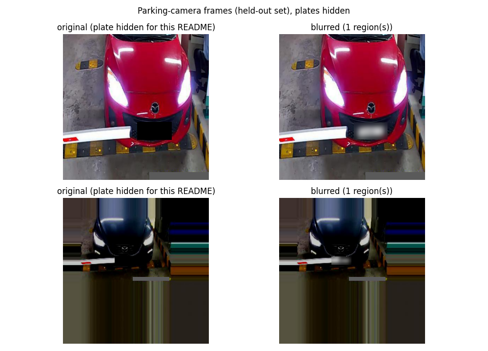
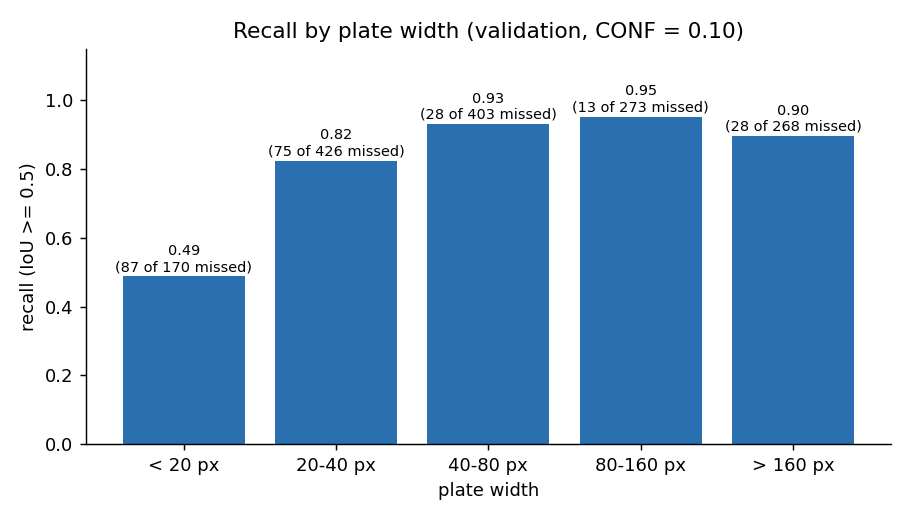
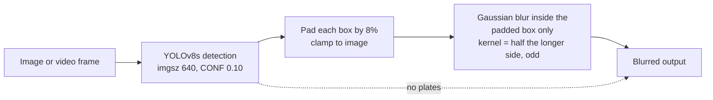

# License Plate Detection & Automatic Blurring

Detects license plates with YOLOv8s and blurs only the plate region in images and video, tuned for recall so that a missed plate (a privacy leak) is far rarer than an extra blurred patch.


## Business problem

Cameras used for traffic monitoring, parking management, insurance claims and data collection capture a license plate in almost every frame. Under GDPR and CCPA a plate is personal data, so images and video must be anonymised before they are stored in the cloud, shared, used to train models or handed to third parties, and doing that by hand does not scale. The two errors are not equal: a **missed plate is a privacy leak**, while a **false positive is just an extra blurred patch**. The system is therefore **recall-first**: I operate at a low confidence threshold (0.10) and judge it by recall against false positives, not by mAP alone.



*Left: original with the plate covered by a black box. Right: output of the pipeline (Gaussian blur inside the padded box). Held-out parking-camera frames; plates in examples are hidden (more examples in [docs/results/](docs/results/)).*

*Example images in this README have plates hidden; the dataset is from a course-shared Google Drive folder.*

## Results

All numbers come from the executed notebook ([notebooks/License_Plate_Detection_Blurring_final.ipynb](notebooks/License_Plate_Detection_Blurring_final.ipynb)); run on Google Colab, Tesla T4, ultralytics 8.4.208. One training run, seed 42.

**Detection metrics** (Ultralytics validation at its default confidence threshold):

| Set | Images | Precision | Recall | mAP@50 | mAP@50-95 |
|---|---:|---:|---:|---:|---:|
| Validation (web photos) | 1,043 | 0.853 | 0.771 | 0.820 | 0.416 |
| Test (web photos) | 386 | 0.914 | 0.812 | 0.881 | 0.640 |
| Held-out parking camera | 400 | 0.999 | 1.000 | 0.995 | 0.674 |

**Operating point, recall at CONF = 0.10** (a plate counts as found if a prediction matches it at IoU >= 0.5):

| Set | Recall | False positives | False positives per image |
|---|---:|---:|---:|
| Validation (threshold chosen here) | 0.850 | 594 | 0.570 |
| Test | 0.891 | 150 | 0.389 |
| Held-out parking camera | 1.000 | 2 | 0.005 |

**Recall by plate width** (validation, CONF = 0.10):

| Plate width | Plates | Recall | Missed |
|---|---:|---:|---:|
| < 20 px | 170 | 0.488 | 87 |
| 20-40 px | 426 | 0.824 | 75 |
| 40-80 px | 403 | 0.931 | 28 |
| 80-160 px | 273 | 0.952 | 13 |
| > 160 px | 268 | 0.896 | 28 |

Plates under 40 px account for about 70% of all misses (162 of 231).



**Blur effectiveness (EasyOCR on the 512 test plates, full pipeline):** OCR could read 201 plates (39.3%) in the original images and 4 (0.8%) after blurring. Of the plates readable before, 2.0% are still readable after (the leak rate). A plate the detector misses stays readable, so this measures the whole system.

**Speed (Tesla T4, batch size 1):**

| Measurement | Time per image | FPS |
|---|---:|---:|
| Detector only (pre-process + inference + NMS) | 13.9 ms | ~72 |
| Full pipeline (read + detect + blur) on test photos | 68.7 ms | ~15 |
| 90-frame 640x480 demo video (read + detect + blur + write) | n/a | ~18 |

The detector is not the bottleneck: the full pipeline is below the 25-30 FPS of a typical camera stream.

More plots: [training curves](docs/results/training_curves.png), [precision-recall curve](docs/results/pr_curve_val.png), [before/after on web photos](docs/results/blur_before_after_web.png) (plates in examples are hidden). The charts are taken directly from the notebook outputs, except recall by width, which is re-plotted from the table printed in the notebook. The before/after figures are re-rendered from the notebook's figures with the plate regions covered, so no readable plate is published. To make your own with real detections, run `python scripts/make_readme_figures.py --weights weights/best.pt --images my_samples/ --output docs/assets/before_after.png` (CPU is fine).

## How it works



Everything outside the padded boxes is copied unchanged; a test in [tests/test_blur.py](tests/test_blur.py) checks that, and the notebook measured 0 changed pixels outside the boxes on 100 test images (150 plates blurred).

## Key technical decisions

- **YOLO-to-pixel conversion with clamping.** Labels store a normalised centre and size; OpenCV needs integer corners. I multiply by the original image size, round, and clamp to `[0, W-1] x [0, H-1]` so border boxes never index outside the image. Checked by unit tests and a 1,000-box round trip.
- **YOLOv8 (single-stage) rather than a two-stage detector.** Blurring needs low latency per frame, easy export to ONNX/TensorRT and a simple model for one rigid, high-contrast class. Two-stage detectors may localise slightly better, but I only need the plate covered, not pixel-perfect boxes. This is a design argument, not a head-to-head experiment (see limitations).
- **The `s` variant (11.1 M parameters, 28.4 GFLOPs).** More capacity than `n` for small plates in cluttered scenes, but light enough for real-time and edge use. `m`, `l` and `x` would multiply training time on a free T4 for a single simple class.
- **Recall-first threshold (CONF = 0.10).** Chosen on validation: going from 0.25 to 0.10 adds about 4 points of recall, while going to 0.05 adds only about 2 more for many more false blurs. On test it finds about 89% of plates for about 0.4 false blurs per image.
- **Blur only inside the padded box.** The detector's box is enlarged by 8% so slightly loose or tight boxes still cover the plate, the blur is applied to a copy of that region, and the kernel scales with the box so both tiny and large plates become unreadable.
- **Leakage and label cleaning.** I removed 43 train images with no or empty label files (most of the ones I inspected showed a clearly visible unlabeled plate, which would teach the model to ignore plates) and 30 validation images whose source photo also appears in train, found by the source-photo base name of each augmented file.
- **Held-out domain evaluation.** Training is about 81% parking-camera images, but validation and test contain only web photos, so I built a separate 400-image parking-camera set from images never used for training, one image per source photo.

## Findings and limitations

- **Domain gap.** Training is about 81% parking-camera frames, while validation and test are web photos only. The validation and test scores therefore measure the harder web-photo domain, and the parking-camera number comes from a different, smaller held-out set.
- **The held-out parking-camera score is optimistic.** Parking cameras are fixed, so backgrounds are similar across different photos, and the set comes from the same cameras as the training data. A new site needs its own acceptance test.
- **Small plates are the main residual risk.** Recall is 0.49 below 20 px and 0.82 at 20-40 px. Part of the sub-20 px figure is annotation noise (one or two pixels is a large IoU change at that size); I cannot separate that from model failure without re-labelling.
- **At CONF = 0.10 about 1 test plate in 9 is still missed**, so fully automatic operation cannot promise 100%.
- **The full pipeline is slower than real time.** About 15-18 FPS end to end on a T4 against about 72 FPS for the detector alone. I did not profile the CPU-side steps (JPEG decode/encode, blur) separately.
- **Single training run, one seed.** No variance estimate. The curves were still rising slowly at epoch 25, so the model is probably slightly under-trained.
- **Trained on a subset.** To keep reading from Drive fast I trained on 11,983 of the 25,625 train images (11,940 after cleaning).
- **OCR is only a proxy for a human reader.** It could read only 39.3% of the original plates, so the leak rate is a lower bound on risk, and a mild blur could in principle be partly reversed by deconvolution.
- **No two-stage baseline and no `n`/`m` comparison.** The architecture and variant choices are argued from specifications and measured latency, and I did not run a controlled ablation of the cleaning steps either.

## Quickstart

All commands run from this folder. Training and evaluation need a GPU for reasonable speed; everything works on CPU, only slowly. The tests need neither a GPU, data nor weights.

```bash
# 1. environment (Windows: .venv\Scripts\activate)
python -m venv .venv
source .venv/bin/activate
pip install -r requirements.txt

# 2. tests (synthetic images only)
python -m pytest

# 3. blur an image, or a whole folder  (weights: see the Dataset section)
python scripts/blur_image.py --weights weights/best.pt --input photo.jpg --output out/photo_blurred.jpg
python scripts/blur_image.py --weights weights/best.pt --input photos/ --output out/

# 4. blur a video
python scripts/blur_video.py --weights weights/best.pt --input clip.mp4 --output out/clip_blurred.mp4

# 5. audit and clean the dataset, then train (defaults: epochs 25, imgsz 640, batch 32, seed 42)
python scripts/audit_dataset.py --root data --clean
python scripts/train.py --data data/data.yaml

# 6. evaluate (add --ocr for the EasyOCR leak check)
python scripts/evaluate.py --weights runs/lp_v8s/weights/best.pt --root data --split test
```

Every script takes `--conf` (default 0.10), `--pad` (0.08) and `--imgsz` (640) where relevant; run it with `--help` for the full list. Optional demo with a confidence slider: `pip install -r demo/requirements.txt` then `python demo/app.py --weights weights/best.pt`.

## Dataset

- **Source:** a shared Google Drive folder from my course, with `images/` and `labels/` in YOLO format and one class (license plate). Image sizes mix mostly 416x416 parking-camera frames with web photos of about 1,024 px width.
- **Expected layout** (YOLO txt: one line per plate, `0 cx cy w h`, normalised 0-1):

  ```text
  data/
  ├── images/{train,val,test}/*.jpg
  ├── labels/{train,val,test}/*.txt
  └── data.yaml            # written by scripts/audit_dataset.py --clean (example: configs/data.yaml.example)
  ```

- **Example images:** the figures in this README have plates hidden. The notebook's embedded outputs show images from the public dataset used for the assignment.
- **Drive IDs:** in the notebook copy, the Drive folder IDs in the data-download cell are replaced with `YOUR_IMAGES_FOLDER_ID` and `YOUR_LABELS_FOLDER_ID`; fill them in to run that cell. The script-based workflow does not need Drive.
- **Not in this repository:** neither the dataset nor the trained weights are committed (`data/`, `runs/` and `*.pt` are git-ignored).
- **Working splits used in the notebook** after cleaning: 11,940 train / 1,043 validation / 386 test.
- **Weights:** TODO: add the download link for the trained `best.pt` here (place it at `weights/best.pt`).

## Folder structure

```text
License_Plate_Detection_Blurring/
├── README.md
├── requirements.txt
├── configs/
│   └── data.yaml.example
├── src/lpblur/
│   ├── coords.py        # YOLO <-> pixel conversion, label reading
│   ├── viz.py           # draw_boxes, before_after
│   ├── blur.py          # padded_box, blur_plates, anonymize
│   ├── dataset.py       # audit, cleaning, leakage detection
│   ├── evaluate.py      # IoU matching, recall vs confidence, recall by size
│   ├── ocr_check.py     # EasyOCR readability proxy, leak rate
│   └── video.py         # frame-by-frame video blurring
├── scripts/
│   ├── train.py
│   ├── evaluate.py
│   ├── blur_image.py
│   ├── blur_video.py
│   ├── audit_dataset.py
│   └── make_readme_figures.py   # before/after figures with plates hidden
├── tests/               # pytest, synthetic data only
├── notebooks/
│   └── License_Plate_Detection_Blurring_final.ipynb
├── docs/
│   ├── results/         # plots and plate-hidden before/after figures
│   └── assets/          # plate-hidden before/after demo images
└── demo/                # optional Gradio app (own requirements.txt)
```

## Future work

- **Small plates:** fine-tune at a larger input size (960-1280 px) and/or add tiled inference for high-resolution inputs, plus more small, distant, night-time and rainy examples.
- **Export:** ONNX / TensorRT (half precision) so anonymisation can run on or next to the camera.
- **Faster blur step:** cap the kernel size or blur a down-scaled copy of each box, use hardware video decoding and batch frames; then re-measure on the target device.
- **Human review queue** for images whose detections are all low-confidence (for example between 0.10 and 0.25), plus a random audit of outputs and a feedback loop that relabels reviewer corrections.
