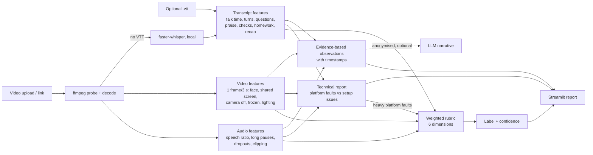

# Class Quality Assessor

Upload (or link) an 8x8 online-class recording, optionally with its platform transcript (`.vtt`), and get a
**Poor / Average / Good / Excellent** verdict, per-dimension scores, a timeline, and 3-6 specific, timestamped
observations with concrete suggestions. Technical/platform faults are flagged **separately** and are not held against the teacher.

## Data handling (read first)

* Recordings and transcripts show children and are **confidential**. `data/`, `cache/`, `outputs/`, `.env` and every media/transcript
  extension are git-ignored. `scripts/check_no_data.sh` fails if any such file is staged; install it as a hook with
  `bash scripts/install_hooks.sh`. Run `bash scripts/check_no_data.sh --history` before submitting.
* **All processing is local** (ffmpeg, OpenCV, numpy, optional faster-whisper). Audio, video and frames are never sent anywhere.
* The app deletes the uploaded recording and temp files when processing ends, stores nothing, and bundles no sample data.
* An LLM narrative is **optional and off by default** (`EXPLAINER_PROVIDER=rule`). If enabled it receives only numeric features and
  short transcript excerpts with speaker names replaced by `Teacher` / `Student A/B/...` (a guard refuses to send a payload that
  still contains a name). Names mangled by the platform ASR cannot be guaranteed to be caught, which is another reason it is off by default.
  **Any external API use with real recordings needs organiser approval.**
* No secrets in the repo; copy `.env.example` to `.env` if you want to change options.

## Run

```bash
python -m venv .venv && source .venv/bin/activate        # Windows: .venv\Scripts\activate
pip install -r requirements.txt                           # ffmpeg is bundled via imageio-ffmpeg; system ffmpeg is used if present
streamlit run streamlit_app.py
pytest -q                                                 # pip install -r requirements-dev.txt first
```

Hosted (Streamlit Community Cloud): main file `streamlit_app.py`, Python 3.11 or 3.12, `packages.txt` installs ffmpeg.
Free tiers are weak: provide the `.vtt` (fast, and gives speaker labels) rather than relying on local Whisper.

## How it works



The rubric dimensions come from the human feedback notes supplied with the dataset (rapport, one-to-one interaction,
energetic/pleasant tone, structure incl. homework & conclusion, pacing, presentation), not from generic ideas.
See `docs/findings.md` for what the data showed and `docs/explanation.md` for the short write-up.

## Layout

```
streamlit_app.py        UI
src/vtt.py, media.py    parsing, ffmpeg helpers
src/features/           audio.py, video.py, transcript.py, asr.py
src/scoring/            rubric.py, technical.py, explain.py, calibration.json
src/pipeline.py         orchestration, caching, time caps, graceful degradation
src/assess.py           features -> verdict + observations
src/fetch.py, llm.py    link download (SSRF-guarded), optional anonymised LLM narrative
scripts/                dataset analysis, calibration, leave-one-out, data-leak guard
tests/                  unit tests for scoring logic
docs/                   findings, explanation, ai_history
```

## Limitations

* Calibrated on **8 labelled classes (2 per label)**; the cut-offs are a sanity-checked heuristic, not a trained model.
* Pedagogy cues are keyword-based on machine-made transcripts (names and Malayalam are often garbled).
* Without a VTT there are no speaker labels, so interaction cannot be measured; local Whisper is slow on free CPUs and weaker on Malayalam.
* Video analysis is coarse: the recordings mostly show the shared screen, so the teacher's face is a small tile.
* Not tested here: the Whisper path on real audio (model download was blocked on the development machine).
