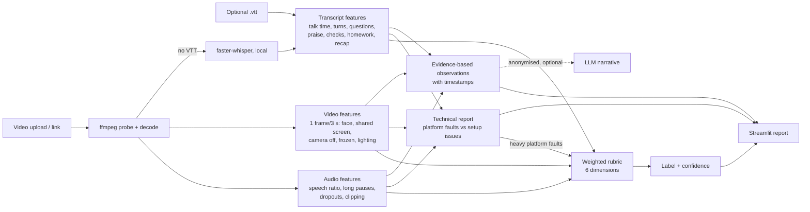

# Class Quality Assessor

**Live app (Streamlit Community Cloud):** https://onlineeducationcompany-5w7mmuuyhoazetwutxvdhx.streamlit.app/

Upload (or link) an 8x8 online-class recording, optionally with its platform transcript (`.vtt`), and get a
**Poor / Average / Good / Excellent** verdict, per-dimension scores, a timeline, and 3-6 specific, timestamped
observations with concrete suggestions. Technical/platform faults are flagged **separately** and are not held against the teacher.

## Data handling (read first)

* Recordings and transcripts show children and are **confidential**. `data/`, `cache/`, `outputs/`, `.env` and every media/transcript
  extension are git-ignored. `scripts/check_no_data.sh` fails if any such file is staged; install it as a hook with
  `bash scripts/install_hooks.sh`. Run `bash scripts/check_no_data.sh --history` before submitting.
* **All processing is local** (ffmpeg, OpenCV, numpy, optional faster-whisper). Audio, video and frames are never sent anywhere.
* The app deletes the uploaded recording and temp files when processing ends, stores nothing, and bundles no sample data.
* An LLM narrative is **optional and off by default** (`EXPLAINER_PROVIDER=rule`). If enabled it receives only numeric features and
  short transcript excerpts with speaker names replaced by `Teacher` / `Student A/B/...` (a guard refuses to send a payload that
  still contains a name). Names mangled by the platform ASR cannot be guaranteed to be caught, which is another reason it is off by default.
  **Any external API use with real recordings needs organiser approval.**
* No secrets in the repo; copy `.env.example` to `.env` if you want to change options.

## Run

```bash
python -m venv .venv && source .venv/bin/activate        # Windows: .venv\Scripts\activate
pip install -r requirements.txt                           # ffmpeg is bundled via imageio-ffmpeg; system ffmpeg is used if present
streamlit run streamlit_app.py
pytest -q                                                 # pip install -r requirements-dev.txt first
```

Hosted on Streamlit Community Cloud (see `docs/hosting.md`, Python 3.11). ffmpeg comes bundled via `imageio-ffmpeg`.
Free tiers are weak: provide the `.vtt` (fast, and gives speaker labels) rather than relying on local Whisper.

## How it works



The rubric dimensions come from the human feedback notes supplied with the dataset (rapport, one-to-one interaction,
energetic/pleasant tone, structure incl. homework & conclusion, pacing, presentation), not from generic ideas.
See `docs/findings.md` for what the data showed and `docs/explanation.md` for the short write-up.

## Layout

```
streamlit_app.py        UI
src/vtt.py, media.py    parsing, ffmpeg helpers
src/features/           audio.py, video.py, transcript.py, asr.py (Whisper), speakers.py (label-free split)
src/scoring/            rubric.py, technical.py, explain.py, calibration.json
src/pipeline.py         orchestration, caching, time caps, graceful degradation
src/assess.py           features -> verdict + observations
src/fetch.py, llm.py    link download (SSRF-guarded), optional anonymised LLM narrative
scripts/                dataset analysis, calibration, leave-one-out, data-leak guard
tests/                  unit tests for scoring logic
deploy/                 Dockerfile + Space README (used by scripts/make_space_bundle.py)
docs/                   findings, explanation, hosting, ai_history, submission_checklist
```

## No transcript? (the likely case for a new upload)

Upload the `.mp4` alone and the app transcribes it locally with faster-whisper (`WHISPER_MODEL`, default `tiny`, int8, CPU,
5-minute windows, time-capped), then separates teacher/children by voice. That split is about 70% accurate, so who-spoke-when
scores are not used; wording, audio and video are. The result shows a banner listing exactly which signals were unavailable and why,
and the confidence is lowered. If the speech model cannot load, the app still returns a verdict from audio/video only.
On two full test classes the verdict was unchanged without the transcript (Excellent, Poor), at lower confidence. Malayalam speech is
not handled by the small Whisper models (they write Tamil script); wording checks switch off automatically.

## Partial recordings

A recording under 20 minutes, one whose first speech is after 10 minutes, or one cut short by the analysis cap is treated as a
partial class: opening-only and closing-only checks (rapport check-in, greeting, new-joiner intro, homework, recap, goodbye) are marked
"not assessable", left out of the score, and the result carries a banner and a lower confidence. Per-minute signals still count
(`src/scoring/partial.py`, `docs/findings.md` section 7).

## Hosting

Live at https://onlineeducationcompany-5w7mmuuyhoazetwutxvdhx.streamlit.app/ (Streamlit Community Cloud, free tier). Hugging Face Docker Spaces were paid-only on the author's account, so that route was not used.
See `docs/hosting.md`: Streamlit Community Cloud (subfolder entrypoint) and a Hugging Face Docker Space built from a
data-free bundle (`python scripts/make_space_bundle.py OUT_DIR`).

## Limitations

* Calibrated on **8 labelled classes (2 per label)**; the cut-offs are a hand-set heuristic, not a trained model. Leave-one-out exact accuracy is
  3/8 (within one class 6/8); only Excellent vs the rest is reliable. See `docs/findings.md`.
* Pedagogy cues are keyword-based on machine-made transcripts (names and Malayalam are often garbled).
* Without a VTT there are no speaker labels; the voice-based split is approximate, so interaction is not scored.
* Video analysis is coarse: the recordings mostly show the shared screen, so the teacher's face is a small tile. Tone and the 8x8 background are not measured.
* The Docker/Hugging Face route (`deploy/`) was never built or run. Hosted results are in `docs/findings.md` section 9.
* Platform-dropout detection can mistake natural silence in screen-recorded lessons for audio cut-outs.
* Short-class thresholds (20 and 10 min) are round numbers, not fitted.
* The 10-minute budget fallback was tested locally, not on the hosted app.
